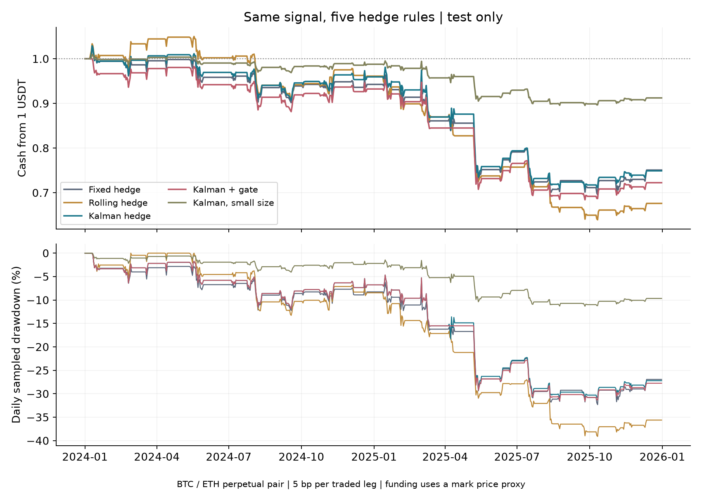

# Pair trade lab

Does a moving hedge help a BTC / ETH pair trade after costs?

I test a fixed hedge, a rolling hedge, and a Kalman filter. They use the same
trade signal. I also test a gate that skips some trades and a smaller position.
The data are free. No account or key is needed.

- 2021–2022: fit the first model.
- 2023: pick one entry level.
- 2024–2025: test it.

## Result

At a cost of 5 bp per traded leg, all five rules lost money in the test.
The moving hedge did not show a clear gain over the fixed hedge.

| Hedge | Test return | Sharpe |
| --- | ---: | ---: |
| Fixed | -24.93% | -0.87 |
| Rolling | -32.39% | -1.35 |
| Kalman | -25.10% | -0.86 |
| Kalman + gate | -27.75% | -1.06 |
| Kalman, small size | -8.77% | -0.86 |

These are two-year test returns, with trade costs and funding payments.
They are not live results or a new method.



## Run

Use Python 3.12. The first run downloads public data.

```sh
python -m pip install -r requirements.txt
python -m unittest -v test_study
python study.py
```

New results go in `run/`. Use `--out run2` for another run.

Read [the short report](REPORT.md), [the rules](NOTES.md), and
[the data notes and terms](DATA.md). Full numbers are in [scores.csv](scores.csv).

AI helped with the code and text. The repo includes tests and data checks.
