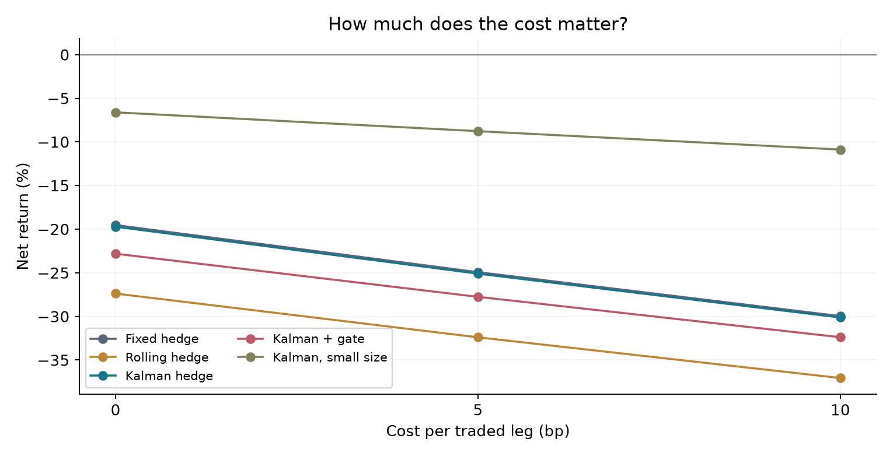

# Does a moving hedge help?

## What I tested

The idea is simple: when ETH moves far from its recent link with BTC, trade
the pair and wait for the gap to shrink. A hedge says how much BTC to hold
against ETH. Does a hedge that changes with new data help?

I use Binance BTCUSDT and ETHUSDT perpetual futures, with hourly data from
2021 to 2025. A perpetual future has funding payments between long and short
positions. The test includes these payments as well as trade costs.

The first two years set the fixed hedge and the first Kalman model. In 2023,
the fixed hedge picks one entry level from 1, 1.5, and 2. The chosen level is
2, with a 2023 Sharpe of 0.70. All rules keep this level for 2024–2025.
The other settings were written down before this run in [plan.json](plan.json).
This is a test on past data, not a trial on new live data.

The three main rules share one signal and the same trade times. Only the
hedge changes. The gate version also skips new trades when the Kalman model's
own estimate of slope error is large. The small-size version is a check on
whether holding less risk alone can help.

## Test result

Each test starts with 1 USDT and no position. The main cost is 5 bp per traded
leg, or 0.05% of the value traded, on both entry and exit. The last position
is closed at the December 31, 2025, 23:00 UTC open, with a closing cost.

| Rule | Net return | Sharpe | Worst drawdown | Mean gross size |
| --- | ---: | ---: | ---: | ---: |
| Fixed | -24.93% | -0.87 | -32.97% | 0.261 |
| Rolling | -32.39% | -1.35 | -39.45% | 0.261 |
| Kalman | -25.10% | -0.86 | -32.01% | 0.261 |
| Kalman + gate | -27.75% | -1.06 | -32.45% | 0.250 |
| Kalman, small size | -8.77% | -0.86 | -11.74% | 0.088 |

Returns cover both test years. Sharpe uses daily net returns, a zero cash
rate, and 365 days per year. Drawdown uses hourly equity. Mean gross size is
the sum of both absolute position values divided by equity, averaged over
all hours, including hours with no position.

The Kalman hedge did not beat the fixed hedge on total return. Its annual
mean daily-return edge was -0.08 percentage points. A paired block check
with 14-day blocks gives a 95% range of -4.53 to +3.96 percentage points.
The range includes zero. Checks with 7-day and 28-day blocks also include
zero. These ranges keep the fitted choices fixed; they do not cover all
possible errors from choosing models or pairs. This is not proof that the
two rules are equal.

## Where the loss came from

Amounts below are USDT per 1 USDT of starting equity. Price PnL is the cash
gain or loss on the actual held coin units. The columns add up as
`net = price + funding - cost`.

| Rule | Price PnL | Funding PnL | Trade cost | Net |
| --- | ---: | ---: | ---: | ---: |
| Fixed | -0.19014 | +0.00185 | 0.06100 | -0.24929 |
| Rolling | -0.26066 | -0.00052 | 0.06274 | -0.32392 |
| Kalman | -0.19003 | +0.00068 | 0.06161 | -0.25097 |
| Kalman + gate | -0.22118 | +0.00048 | 0.05685 | -0.27755 |
| Kalman, small size | -0.06545 | +0.00027 | 0.02250 | -0.08767 |

All rules also lost money at zero trade cost. So the loss is not just a fee
problem. The fixed rule lost 19.53% at zero cost and 29.96% at 10 bp. The
Kalman rule lost 19.72% and 30.12% at those costs.

The gate looked better in 2023, but this did not carry into the test. Its
mean gross size rose from 0.092 in 2023 to 0.250 in the test. The small-size
rule kept a scale of 0.337 set in 2023, so it no longer matched the gate's
test size. Its smaller loss does not show a better trade signal.

In 2024, the fixed and Kalman rules lost 5.74% and 4.05%. In 2025, they lost
20.36% and 21.93%. One extra hour of trade delay still gave losses: 21.77%
for fixed and 22.33% for Kalman.

## What this says

Changing the hedge did not fix this shared trade signal. Even in the first
fit, the spread's rough half-life was about 1,128 hours, much longer than
the 72-hour trade limit. This is a warning about the idea that the gap will shrink, not
proof that the spread follows that fitted model. A rolling mean can also
move toward the price without the price moving back.

This small test gives no basis to trade the rule. It shows how to reject an
idea with clear data, time rules, costs, and held-position accounting.
The code never counts a change in the fitted hedge as cash profit.

## What is still missing

This is one chosen pair on one venue. Hourly opens are assumed fills; there
is no order book, size limit, or model of margin calls. Funding uses real
rates but hourly mark opens as price proxies. There is no cash yield.
A checksum shows that a file matches its source, not that every source
price is right. Past data may be changed by the source later.

The next useful test would use other pairs and a new time period under
rules set first. I have not run that test here.

See [NOTES.md](NOTES.md) for the exact rules and prior work,
[DATA.md](DATA.md) for source terms, and [result.json](result.json) for the
full run record. `*-days.csv` files show daily cash changes. `*-orders.csv`
files show planned weights and held units at each trade-clock time, plus
the final close; flat rows are kept. `rebalance_count` counts times with
nonzero traded value, not completed round trips.
